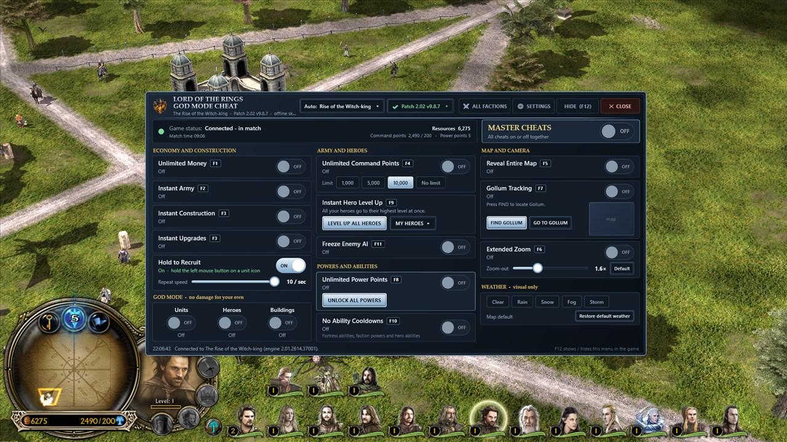
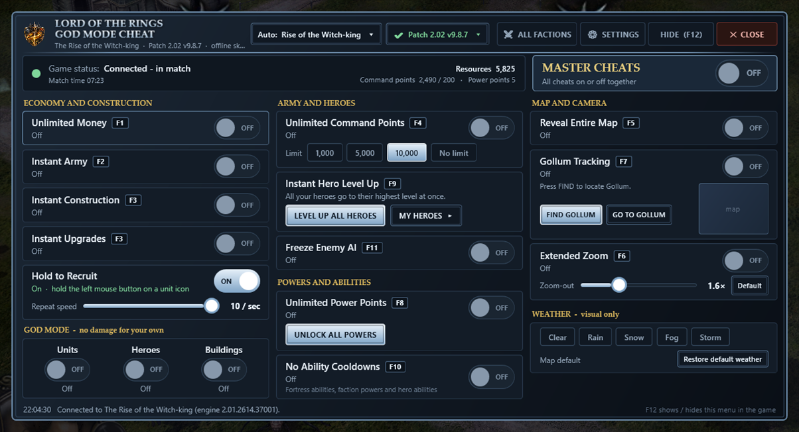
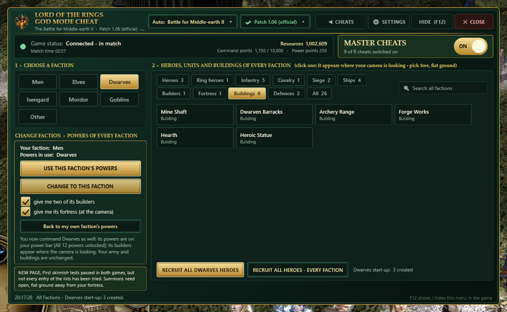
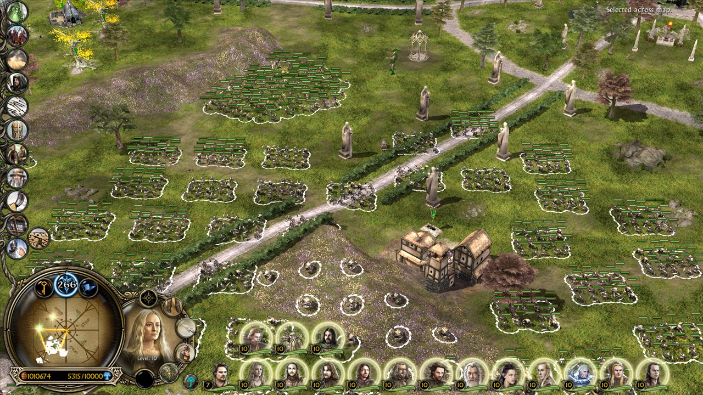
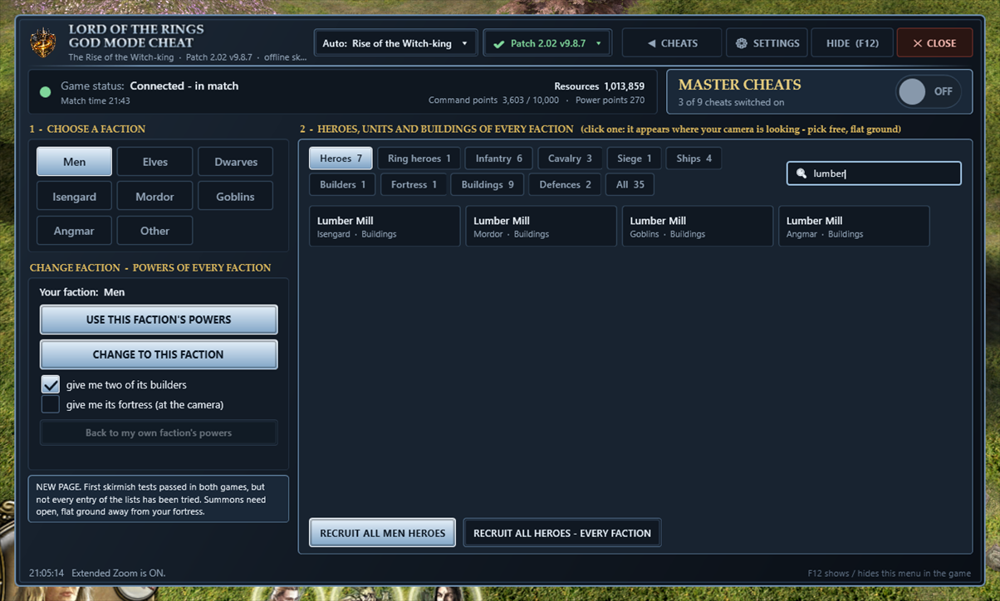
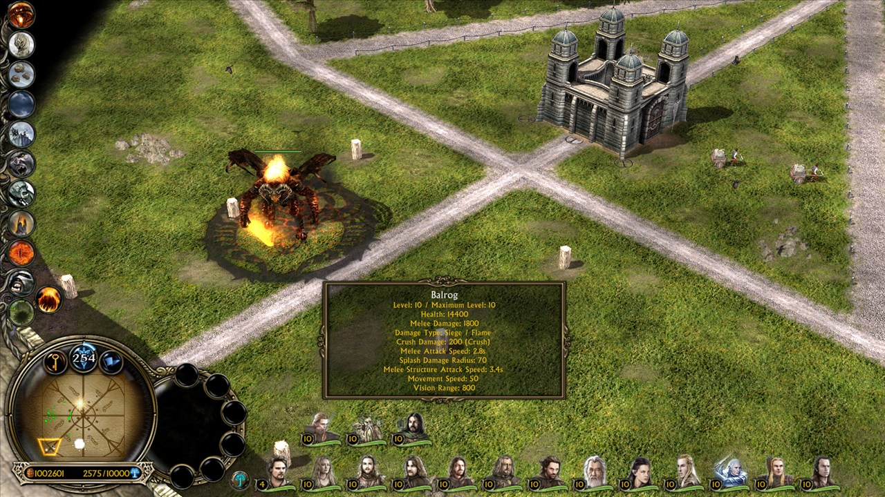
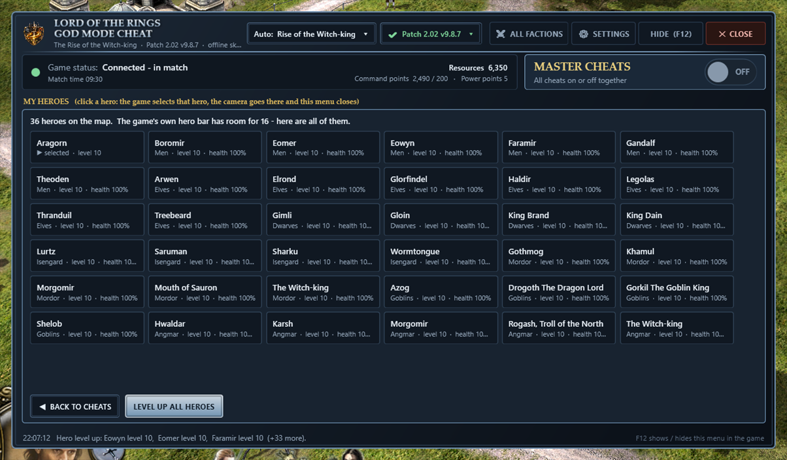
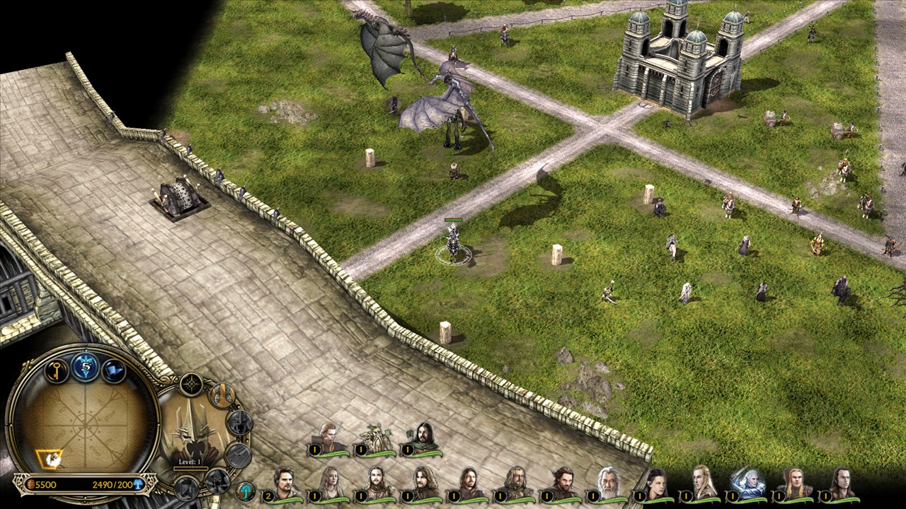
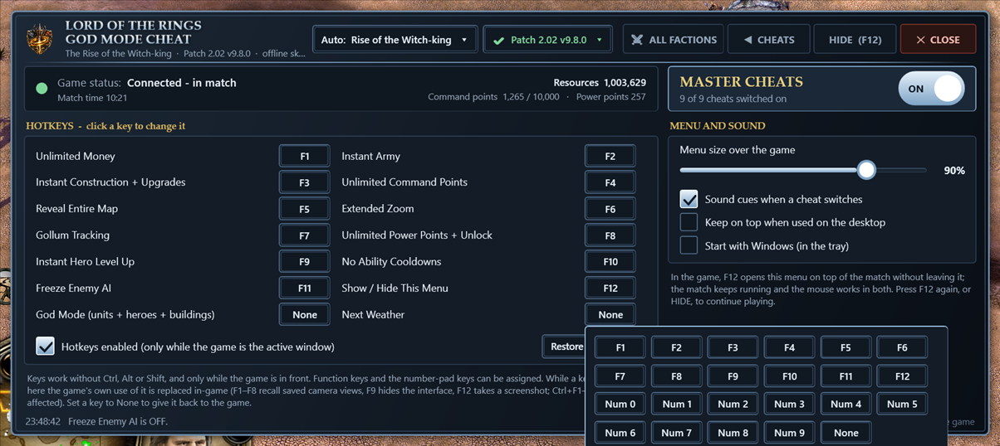

# Lord of the Rings God Mode Cheat

An offline skirmish trainer for two classic strategy games:

- **The Lord of the Rings: The Battle for Middle-earth II** (Patch 1.06)
- **The Lord of the Rings: The Rise of the Witch-king** (community Patch 2.02, releases 9.8.0 and 9.8.7)

One program serves both games. It finds the running game by itself, switches to that game's look, and opens as a menu on top of your match when you press **F12**.



> **Offline single-player skirmish only.** The trainer does not activate in multiplayer, in the campaign or in replays, and it contains no network code at all. Please keep it out of online games.

---

## Contents

- [What it can do](#what-it-can-do)
- [What you need](#what-you-need)
- [Download and install](#download-and-install)
- [Tutorial](#tutorial)
  - [1. Start the trainer and a skirmish](#1-start-the-trainer-and-a-skirmish)
  - [2. The CHEATS page](#2-the-cheats-page)
  - [3. The ALL FACTIONS page](#3-the-all-factions-page)
  - [4. Powers of other factions](#4-powers-of-other-factions)
  - [5. MY HEROES](#5-my-heroes)
  - [6. Settings and hotkeys](#6-settings-and-hotkeys)
  - [7. Closing and uninstalling](#7-closing-and-uninstalling)
- [Hotkeys](#hotkeys)
- [Limits you should know](#limits-you-should-know)
- [Questions and problems](#questions-and-problems)
- [Safety, privacy and antivirus](#safety-privacy-and-antivirus)
- [What has been tested](#what-has-been-tested)
- [Building from source](#building-from-source)
- [Disclaimer](#disclaimer)

---

## What it can do

**Economy and construction**

| Cheat | What it does |
|---|---|
| Unlimited Money | Keeps your resources at 999,999. |
| Instant Army | Your units and heroes recruit instantly. |
| Instant Construction | Your buildings complete instantly, walls included. |
| Instant Upgrades | Fortress upgrades, building level-ups and research finish instantly. |
| Hold to Recruit | Hold the left mouse button on a unit icon and the order repeats until you let go. |

**Army and heroes**

| Cheat | What it does |
|---|---|
| Unlimited Command Points | Raises your limit to 1,000 / 5,000 / 10,000 / no limit. |
| Level Up All Heroes | Every hero you have on the map goes to the highest level. |
| My Heroes | A list of all your heroes; click one to select it in the game and jump to it. |
| Freeze Enemy AI | Computer opponents stop attacking, building and recruiting until you switch it off. |
| God Mode | Three separate switches: your units, your heroes, your buildings take no damage. |

**Powers and abilities**

| Cheat | What it does |
|---|---|
| Unlimited Power Points | Keeps your power points at 250. |
| Unlock All Powers | Grants every power of your faction's tree at once. |
| No Ability Cooldowns | Fortress abilities, faction powers and hero abilities are ready again right after use. |

**Map, camera and weather**

| Cheat | What it does |
|---|---|
| Reveal Entire Map | Removes the fog of war for you only. |
| Gollum Tracking | Marks Gollum on the minimap and can move the camera to him. |
| Extended Zoom | Lets you zoom out up to three times farther. |
| Weather | Clear, rain, snow, fog or storm. Visual only. |

**All factions in one match**

| Feature | What it does |
|---|---|
| Heroes, units and buildings of every faction | Click a tile and that hero, battalion or finished building appears where your camera is looking. |
| Recruit all heroes | All heroes of one faction, or of every faction, with one button. No hero is created twice. |
| Use another faction's powers | Puts that faction's powers on your power bar and unlocks its whole tree. |
| Change to another faction | Its powers, two of its builders and, if you tick it, its fortress. Your own army stays yours. |

Only your own player is changed. Computer opponents keep their normal money, limits, build times and cooldowns.

---

## What you need

- Windows 10 or 11. The trainer uses the .NET Framework 4 that ships with Windows; nothing else has to be installed.
- One of the two games, on a supported patch:

| Game | Supported (play-tested) | Not verified |
|---|---|---|
| The Rise of the Witch-king | Patch 2.02 v9.8.0 and v9.8.7 | Patch 2.01, other 2.02 releases, mods |
| The Battle for Middle-earth II | Patch 1.06 | Patch 1.09 |

The trainer checks the running game's program code before it does anything. On a patch that is not verified the cheats stay off unless you tick **Allow cheats on NOT VERIFIED patches** in the patch list yourself. On a game build it does not know at all, it does nothing.

---

## Download and install

Get the files from the [Releases](../../releases) page.

| File | Use it when |
|---|---|
| `LordOfTheRingsGodModeCheat-Setup.exe` | You want a normal installation with a desktop shortcut and an entry in Windows' list of apps. |
| `LordOfTheRingsGodModeCheat-1.0-Portable.zip` | You want no installation. Unzip it anywhere and start the program from that folder. |
| `SHA256SUMS.txt` | You want to check that your download is unchanged. |

**Installer.** Run the setup program and press Install. It installs for your Windows account only and needs no administrator rights.

**Portable copy.** Unzip the folder and start `LordOfTheRingsGodModeCheat.exe`. Settings stay in a `TrainerData` folder next to the program. Delete the folder to remove it.

**Two warnings to expect.** The files are not code-signed, so Windows SmartScreen will say "unknown publisher" the first time. And when the trainer starts, Windows asks for administrator rights, because the games themselves run as administrator and a normal program is not allowed to reach into them. See [Safety, privacy and antivirus](#safety-privacy-and-antivirus).

---

## Tutorial

### 1. Start the trainer and a skirmish

1. Start **Lord of the Rings God Mode Cheat** and confirm the Windows prompt.
2. Start either game and begin a skirmish against the computer.
3. In the match, press **F12**. The menu opens on top of the game. The match keeps running and you stay in the game.
4. Click what you want, then press **F12** again or **HIDE** to keep playing.

The order does not matter: you can also start the game first. If you start the trainer while a match is already on screen, its menu opens over the game by itself.

Switches you set before a match stay set. They apply when the match starts, and again in every new match.

### 2. The CHEATS page



- Each card has a switch on the right. Green text under the name tells you what the cheat is doing right now.
- The small box next to a name shows its hotkey.
- **MASTER CHEATS** at the top right switches the nine main cheats on or off together.
- The two lists at the top show which **game** and which **patch** were found. A green tick means the patch is verified.
- The line at the bottom shows the last thing the trainer did.

A good first try: switch on **Unlimited Money** and watch your resources in the status card at the top.

### 3. The ALL FACTIONS page

Click **ALL FACTIONS** at the top of the menu.



1. Move the game camera to free, flat ground first. New things appear where the camera is looking.
2. Choose a faction on the left.
3. Choose a group on the right: Heroes, Infantry, Cavalry, Buildings and so on.
4. Click a tile. The hero, battalion or finished building is created for you.

Nothing is put on top of anything else. If something already stands at that spot, the new thing takes the nearest free place beside it, so you can click one tile after another without moving the camera.



Units cost their normal command points, so switch on **Unlimited Command Points** before you create a large army. Nothing costs money.

**Search.** Click the search box and type part of a name. It looks through all factions at once. Press Enter to keep the result, Esc to clear it. While the box is active, the letters go to the trainer and not to the game.



**Recruit all heroes.** The two buttons at the bottom create all heroes of the chosen faction, or of every faction. A hero you already have is skipped.

### 4. Powers of other factions

On the ALL FACTIONS page, choose a faction and press one of the two large buttons on the left.

| Button | Result |
|---|---|
| **USE THIS FACTION'S POWERS** | That faction's powers are on your power bar and its whole tree is unlocked. |
| **CHANGE TO THIS FACTION** | The same, plus two of its builders and, if ticked, its fortress at the camera. |
| **Back to my own faction's powers** | Your own power bar again. |

The builders you receive build all of that faction's buildings in the normal way, and those buildings recruit all of its units.



Other factions' powers work together with **Unlimited Power Points** and **No Ability Cooldowns**.

### 5. MY HEROES

The games' own hero bar at the bottom of the screen has room for 16 portraits. With the heroes of every faction you will have many more. Press **MY HEROES** on the CHEATS page to see them all.



Click a hero. The game selects that hero, the camera goes there and the menu closes, so you can give orders at once.



**LEVEL UP ALL HEROES** is on this page as well. If the game is paused when you click a hero, resume it and click again.

### 6. Settings and hotkeys

Click **SETTINGS** at the top of the menu.



- Click a key box to give that action another key: F1 to F12, a number-pad key, or None.
- **God Mode** and **Next Weather** have no key at first. Give them one here if you want.
- **Menu size over the game** makes the in-game menu smaller or larger.
- **Start with Windows** keeps the trainer waiting in the tray. It is off unless you tick it.

Number-pad keys only work as hotkeys while NumLock is on.

### 7. Closing and uninstalling

Press **CLOSE** in the menu. All cheats are switched off and the game's own values are put back.

To remove the program, use Windows Settings > Apps > Installed apps > Lord of the Rings God Mode Cheat > Uninstall. The portable copy is removed by deleting its folder.

---

## Hotkeys

Plain keys, without Ctrl or Alt. They only work while the game is the active window.

| Key | Action | Key | Action |
|---|---|---|---|
| F1 | Unlimited Money | F7 | Gollum Tracking |
| F2 | Instant Army | F8 | Unlimited Power Points + Unlock All Powers |
| F3 | Instant Construction + Upgrades | F9 | Level Up All Heroes |
| F4 | Unlimited Command Points | F10 | No Ability Cooldowns |
| F5 | Reveal Entire Map | F11 | Freeze Enemy AI |
| F6 | Extended Zoom | F12 | Show / hide the menu |

A rising tone means ON, a falling tone means OFF.

While a key belongs to the trainer, the game's own use of that key is replaced in the match: F1 to F8 normally recall saved camera views, F9 hides the interface and F12 takes a screenshot. Set a key to None on the SETTINGS page to give it back to the game.

---

## Limits you should know

These come from how the games are built. The trainer explains them instead of offering a switch that only pretends to work.

- **Your faction itself does not change.** "Change to this faction" gives you the other faction's powers, builders, buildings, units and heroes in addition to your own. Existing units are not converted.
- **One power bar at a time.** The games give every player exactly one set of powers. Switching takes one click.
- **The buy-powers screen and the fortress hero buttons stay those of your starting faction.** A hero of another faction that dies is recruited again from the trainer, not revived at a fortress.
- **The hero bar shows 16 heroes and no more.** Use MY HEROES for the rest.
- **Summons need open, flat ground away from your fortress.** On a slope, among trees or beside the fortress the game refuses the cast without a message.
- **Walls can only be built near your own fortress.** That is the game's rule.
- **The trainer cannot see cliffs or water.** Look at flat ground before you create something, especially a building.
- **Not offered:** create-a-hero characters, wall pieces, fortress add-ons and creatures that belong to a lair.
- **Saved games keep what the cheats gave you.** Money and a raised command point limit are part of the save.
- **A loaded save can come up with another faction's power bar.** With the trainer running, it notices and puts your own bar back within seconds.
- **One thing is left in the running game when the trainer closes:** a limit of 600 health bars per picture. The games crash by themselves at about 900, and a very large army is still there after the trainer has closed. The limit is gone when the game closes.

---

## Questions and problems

**The switches are grey or the status says "not verified".**
The trainer found a patch it has not been tested on. Open the patch list at the top of the menu. You can tick "Allow cheats on NOT VERIFIED patches" at your own risk.

**F12 does nothing.**
The trainer must be running and the game must be the active window. Check the tray for the trainer's icon. If you gave the menu another key on the SETTINGS page, use that key.

**A page says "Not available on this game version".**
The trainer compared the game's code with what was analysed, found a difference and did nothing. That is its safety check, not a crash.

**A summon power does nothing.**
Try open, flat ground away from your fortress. See [Limits you should know](#limits-you-should-know).

**Number-pad hotkeys do nothing.**
Switch NumLock on.

**Another trainer is running at the same time.**
Two trainers changing the same values can conflict. Use one at a time.

**Something went wrong and I want to report it.**
The trainer keeps a small diary of what was switched and when in `%APPDATA%\LordOfTheRingsGodModeCheat\session.log` (portable copy: `TrainerData\session.log`). Please include the relevant lines, the game and the patch. The diary contains switch names, object names and map positions; it holds no personal data.

---

## Safety, privacy and antivirus

The full statement is in [SECURITY.txt](src/Setup/SECURITY.txt). The short version:

- **No network code.** The program never connects to anything. There is no telemetry, no update check, no advertising and no bundled software.
- **No game files are changed.** Everything happens in the memory of the running game. No patch, map or save file is modified.
- **Why administrator rights.** The games run as administrator. Windows does not let a normal program read or write the memory of an elevated one, so the trainer has to be elevated too. It asks through the normal Windows prompt and does not bypass it.
- **What it stores on your PC.** Its settings and the diary mentioned above, in your own profile. Uninstalling removes them.
- **Antivirus warnings are possible.** A trainer writes into another program's memory and listens for hotkeys. Those are the same techniques that harmful programs use, so some antivirus products flag trainers on principle. This project does nothing to hide from antivirus software. If your antivirus objects, the choice is yours; the source is here to read and to build yourself.
- **Not code-signed.** Windows SmartScreen will show "unknown publisher". `SHA256SUMS.txt` lets you check that a download is unchanged.

---

## What has been tested

Honest status, not a guarantee.

| Area | Status |
|---|---|
| CHEATS page | Play-tested in real skirmishes in both games on the supported patches. |
| ALL FACTIONS page | A first round of skirmish tests passed in both games: units, heroes, buildings, fortresses, builders, other factions' powers, changing faction, save and load. |
| Unit and building lists | About a dozen kinds per game were tried. The lists have **not** been played through entry by entry. |
| MY HEROES | Tested in both games with 36 and 28 heroes. |
| Not tested | Ships, the "Other" group (inns, lairs), long matches, windowed mode, starting factions other than Men, Patch 1.09, Patch 2.01. |

[TESTING-GUIDE.txt](src/Setup/TESTING-GUIDE.txt) has short manual tests for the ALL FACTIONS page, with what "good" and "bad" look like.

The version number stays at 1.0. Builds are told apart by their date and by `SHA256SUMS.txt`.

---

## Building from source

You need only Windows. The build uses the C# compiler that ships with the .NET Framework; no SDK, no packages and no downloads.

```powershell
powershell -ExecutionPolicy Bypass -File build.ps1 -Release
```

The program and the installer are written to `build\`, and the release files to `dist\`.

| Folder | Contents |
|---|---|
| `src\Core` | The engine: finding the game, checking its code, the cheats. |
| `src\App` | The menu, hotkeys, settings and the unit lists for both games. |
| `src\Setup` | The installer and the documents that ship with the program. |
| `src\Shared` | Names and paths used by both the program and the installer. |
| `dev\tools` | The icon builder and the tool that generates the unit lists from a game's own data files. |

`sign.ps1` signs the two programs if you have your own code-signing certificate.

---

## Disclaimer

This is a free fan project. It is not affiliated with, endorsed by or supported by Electronic Arts, Warner Bros., Middle-earth Enterprises, the Tolkien Estate or the Patch 2.02 team. All trademarks belong to their owners. No game files are included.

Use it at your own risk, and only in offline skirmishes against the computer.

The program icon is an AI-generated image.
